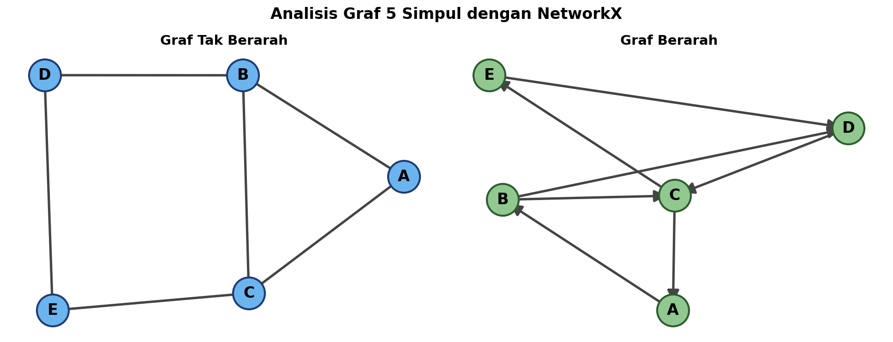
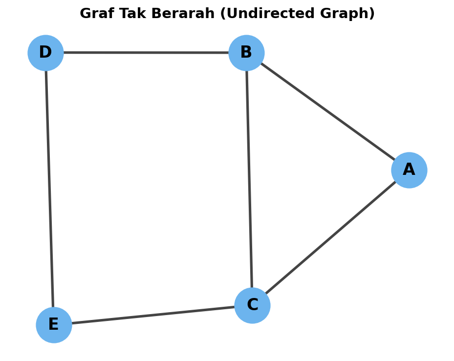
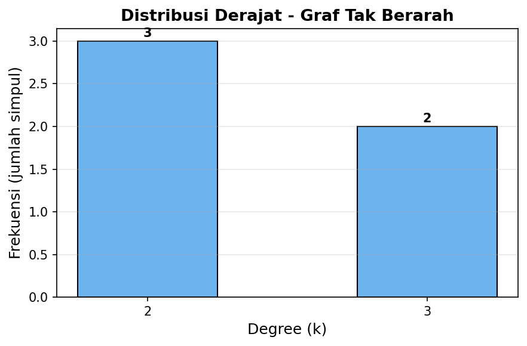
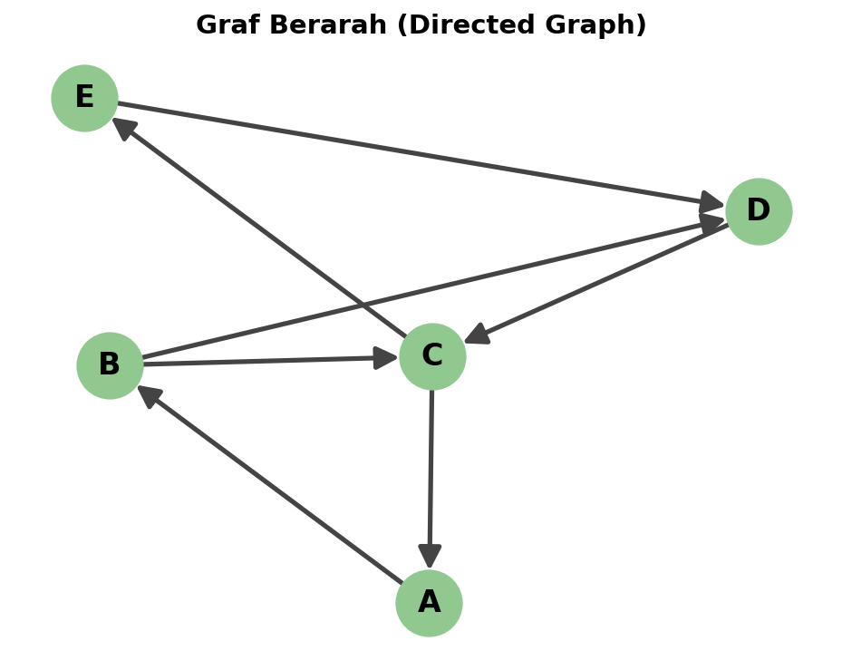
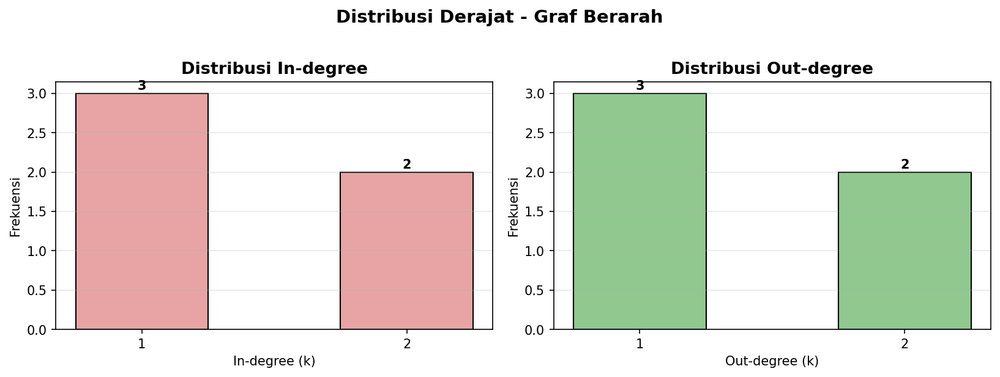

<div align="center">

# Analisis Graf Berarah & Tak Berarah dengan NetworkX

### Tugas Web Structure Mining Karakterisasi Graf 5 Simpul


**[Lihat Live Demo (GitHub Pages)](https://haninhammoud01.github.io/analisis-graf-networkx/)**

</div>

<br>

<p align="center">
  
</p>

<br>

## Daftar Isi

- [Tentang Project](#tentang-project)
- [Konsep Teori (dari PPT Dosen)](#konsep-teori-dari-ppt-dosen)
- [Hasil Analisis Singkat](#hasil-analisis-singkat)
- [Struktur Folder](#struktur-folder)
- [Cara Menjalankan](#cara-menjalankan)
- [Live Demo (GitHub Pages)](#live-demo-github-pages)
- [Cara Upload ke GitHub](#cara-upload-ke-github)
- [Cara Aktifkan GitHub Pages](#cara-aktifkan-github-pages)
- [Library yang Dipakai](#library-yang-dipakai)
- [Referensi](#referensi)

<br>

## Tentang Project

Project ini menganalisis **dua buah graf** yang masing-masing memiliki **5 simpul (vertex)**, satu **graf tak berarah** dan satu **graf berarah**, menggunakan library **`networkx`** di Python.

Setiap graf dianalisis untuk metrik-metrik berikut:

| Metrik | Graf Tak Berarah | Graf Berarah |
|--------|:---:|:---:|
| Matriks Ketetanggaan (Adjacency Matrix) | ya | ya |
| Derajat (Degree) tiap simpul | ya | in-degree + out-degree |
| Distribusi Derajat (Degree Distribution) | ya | ya (in & out) |
| Derajat Rata-rata (Average Degree) | ya | ya |
| Kepadatan Graf (Density) | ya | ya |
| Lintasan Terpendek & Rata-ratanya | ya | ya |
| Koefisien Klasterisasi (Clustering Coefficient) | ya | ya |

<br>

## Konsep Teori (dari PPT Dosen)

> Materi mengikuti PPT **"Web Structure Mining"** Bab *Mendeskripsikan Graf: Terminologi dan Metrik*.

### Definisi Dasar
- **Graf** `G = (V, E)` adalah pasangan terurut dari himpunan simpul `V` dan himpunan sisi `E`.
- **Graf Tak Berarah**: sisi `(a, b)` = `(b, a)` (simetris). Contoh: tautan koautor, jalan umum.
- **Graf Berarah**: sisi `(a, b)` ≠ `(b, a)`. Sisi berarah disebut **busur (arc)**. Contoh: hyperlink WWW, follow Twitter.

### Rumus-Rumus yang Dipakai

**Derajat (Degree):**
- Graf tak berarah: `d(v)` = jumlah sisi yang terhubung dengan `v`
- Graf berarah:
  - `k_in(v) = Σ a_ji` (in-degree)
  - `k_out(v) = Σ a_ij` (out-degree)
  - Total: `k(v) = k_in(v) + k_out(v)`

**Derajat Rata-rata:**
- Tak berarah: `<k> = 2L / N`
- Berarah: `<k_in> = <k_out> = L / N`, `<k_total> = 2L / N`

**Kepadatan Graf (Density):**
- Tak berarah: `L_maks = N(N-1)/2`
- Berarah: `L_maks = N(N-1)`
- `Density = L / L_maks`

**Koefisien Klasterisasi (Clustering Coefficient):**
```
C_i = 2 * k_i / (d_i * (d_i - 1))
```
`k_i` = jumlah sisi di antara tetangga simpul `i`, `d_i` = derajat simpul `i`. Nilai `C_i ∈ [0, 1]`.

**Lintasan Terpendek (Shortest Path):**
- Jarak `d(i, j)` = jumlah sisi sepanjang jalur terpendek yang menghubungkan `i` dan `j`.
- Pada graf berarah, lintasan harus **mengikuti arah busur**, sehingga `d(i, j)` ≠ `d(j, i)` umumnya.

<br>

## Hasil Analisis Singkat

### Graf Tak Berarah (5 simpul, 6 sisi)

<p align="center">
  
</p>

| Simpul | Degree |
|:---:|:---:|
| A | 2 |
| B | 3 |
| C | 3 |
| D | 2 |
| E | 2 |

- **Derajat rata-rata**: `2.4`
- **Density**: `0.6` (6 dari 10 sisi maksimum)
- **Rata-rata lintasan terpendek**: `1.4`
- **Diameter**: `2`
- **Rata-rata koefisien klasterisasi**: `0.333`

<details>
<summary>Lihat koefisien klasterisasi tiap simpul</summary>

| Simpul | C_i |
|:---:|:---:|
| A | 1.0000 |
| B | 0.3333 |
| C | 0.3333 |
| D | 0.0000 |
| E | 0.0000 |

</details>

<p align="center">
  
</p>

---

### Graf Berarah (5 simpul, 7 busur)

<p align="center">
  
</p>

| Simpul | In-degree | Out-degree | Total |
|:---:|:---:|:---:|:---:|
| A | 1 | 1 | 2 |
| B | 1 | 2 | 3 |
| C | 2 | 2 | 4 |
| D | 2 | 1 | 3 |
| E | 1 | 1 | 2 |

- **Average in-degree**: `1.4`
- **Average out-degree**: `1.4`
- **Average total degree**: `2.8`
- **Density**: `0.35` (7 dari 20 busur maksimum)
- **Rata-rata lintasan terpendek**: `1.9`
- **Rata-rata koefisien klasterisasi**: `0.383`

<p align="center">
  
</p>

---

### Tabel Perbandingan

| Metrik | Tak Berarah | Berarah |
|--------|:---:|:---:|
| Jumlah simpul (N) | 5 | 5 |
| Jumlah sisi (L) | 6 | 7 |
| Derajat rata-rata | 2.4 | 2.8 |
| Density | 0.6 | 0.35 |
| Rata-rata lintasan terpendek | 1.4 | 1.9 |
| Diameter | 2 | - |
| Rata-rata koefisien klasterisasi | 0.333 | 0.383 |

<br>

## Struktur Folder

```
analisis-graf-networkx/
│
├── Analisis_Graf_NetworkX.ipynb   # Notebook utama (sudah berisi output & grafik)
├── README.md                       # Dokumentasi project (file ini)
├── requirements.txt                # Daftar library yang dibutuhkan
├── LICENSE                         # Lisensi MIT
├── .gitignore                      # File yang diabaikan git
│
├── docs/                           # Untuk GitHub Pages
│   └── index.html                  # Versi HTML statis notebook (live preview)
│
└── images/                         # Gambar untuk README & dokumentasi
    ├── cover.png
    ├── graf_tak_berarah.png
    ├── graf_berarah.png
    ├── dist_degree_undirected.png
    └── dist_degree_directed.png
```

<br>

## Cara Menjalankan

### Opsi A Google Colab (paling gampang, tanpa install)

1. Buka https://colab.research.google.com
2. `File` > `Upload notebook`
3. Pilih file `Analisis_Graf_NetworkX.ipynb`
4. `Runtime` > `Run all`

### Opsi B Jupyter Notebook lokal

```bash
# 1. Clone repo ini
git clone https://github.com/haninhammoud01/analisis-graf-networkx.git
cd analisis-graf-networkx

# 2. Install dependency
pip install -r requirements.txt

# 3. Buka notebook
jupyter notebook Analisis_Graf_NetworkX.ipynb
```

> Output semua cell sudah ter-embed di dalam notebook, jadi langsung tampil sebagai web statis di GitHub tanpa perlu di-run ulang.

<br>

## Live Demo (GitHub Pages)

Setelah mengaktifkan GitHub Pages (lihat [Cara Aktifkan GitHub Pages](#cara-aktifkan-github-pages)), notebook bisa diakses sebagai **web statis** di:

```
https://haninhammoud01.github.io/analisis-graf-networkx/
```

Versi HTML statis (`docs/index.html`) sudah aku convert dari notebook asli semua output text, matriks, dan grafik tetap tampil tanpa perlu menjalankan kode. Cocok untuk dilihat dosen / orang lain yang belum install Python.

<br>

## Cara Upload ke GitHub

1. **Buat repo kosong** di https://github.com/new
   - Repository name: `analisis-graf-networkx` (atau bebas)
   - Public, **jangan** centang "Add a README" (kita sudah punya)
   - Klik **Create repository**

2. **Dari terminal VSCode**, di dalam folder project:
```bash
git init
git branch -M main
git add .
git commit -m "Initial commit: Tugas Web Structure Mining - Analisis Graf dengan NetworkX"
git remote add origin https://github.com/haninhammoud01/analisis-graf-networkx.git
git push -u origin main
```

3. Saat `git push`, GitHub akan minta login:
   - **Browser**: otomatis kebuka, login aja
   - **Token**: bikin PAT di https://github.com/settings/tokens (scope: `repo`), paste sebagai password

<br>

## Cara Aktifkan GitHub Pages

Setelah repo ter-upload lengkap (termasuk folder `docs/`), aktifkan Pages supaya notebook tampil sebagai web statis:

1. Buka repo kamu di GitHub → klik tab **Settings** (bukan Settings di profil, tapi di menu repo bagian atas)
2. Sidebar kiri → **Pages**
3. Pada section **Build and deployment**:
   - **Source**: pilih **Deploy from a branch**
   - **Branch**: pilih `main`, folder: `/docs`
   - Klik **Save**
4. Tunggu 1-2 menit, lalu refresh halaman akan muncul link:
   ```
   https://haninhammoud01.github.io/analisis-graf-networkx/
   ```
5. Buka link itu di browser → notebook akan tampil sebagai halaman web lengkap dengan output, matriks, dan grafik.

> **Catatan**: GitHub Pages butuh waktu ~1-2 menit untuk build pertama kali. Kalau muncul "404 There isn't a GitHub Pages site here", tunggu dulu lalu refresh.

<br>

## Library yang Dipakai

```txt
networkx==3.x
matplotlib==3.x
numpy==1.x
jupyter
```

Semua library ini sudah pre-installed di Google Colab, jadi cukup buka notebook-nya langsung jalan.

<br>

## Referensi

1. **PPT Dosen *Web Structure Mining***. Bab *Mendeskripsikan Graf: Terminologi dan Metrik* definisi graf, matriks ketetanggaan, derajat (in-degree/out-degree), distribusi derajat, derajat rata-rata, kepadatan graf, koefisien klasterisasi, lintasan, jalur terpendek, diameter.
2. **Bing Liu *Web Data Mining***, Chapter 7 (referensi yang disebut di PPT untuk PageRank & rank prestise).
3. NetworkX Documentation https://networkx.org/documentation/stable/
4. Hagberg, Aric, Daniel Schult, and Pieter Swart. *Exploring Network Structure, Dynamics, and Function using NetworkX*. SciPy 2008.
5. Fagiolo, G. *Clustering in complex directed networks*. Physical Review E, 76(2), 026107, 2007 (rumus clustering coefficient untuk graf berarah yang dipakai NetworkX).

<br>

<div align="center">

### Dibuat untuk Tugas Web Structure Mining

**Mata Kuliah**: Web Structure Mining
**Tools**: Python, NetworkX, Jupyter Notebook, Google Colab

</div>
